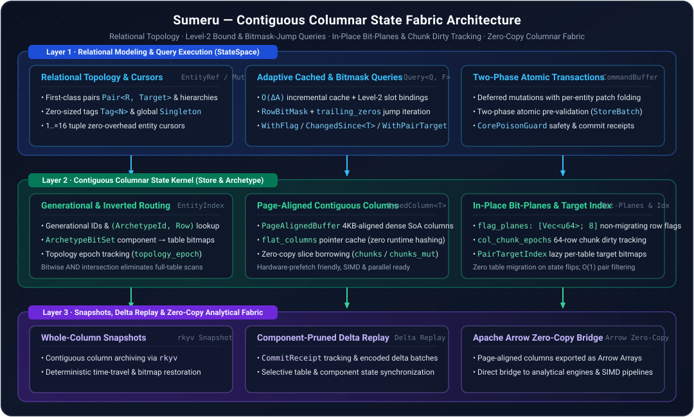

# SumerState

[](LICENSE)
[](Cargo.toml)
[](Cargo.toml)

English | [简体中文](README_zh-CN.md)

**SumerState is a high-performance contiguous columnar in-memory state engine written in Rust.** Built for large-scale simulations, digital twins, real-time games, and data-intensive stateful systems, it unifies expressive relational state modeling, deterministic transactional evolution, and a zero-copy columnar data foundation.

---

## Philosophy

Traditional game frameworks (such as ECS) excel at fast frame-local loops but treat world state as ephemeral memory without strict storage contracts. Conversely, in-memory databases provide transactional rigor but lack the cache-coherent ergonomics and fine-grained throughput required by real-time simulations.

Rather than being just an ECS container, SumerState elevates world state into a first-class **Columnar State Fabric**—combining entity-component cache locality and rich relational topology with transactional safety, deterministic time-travel snapshots, and zero-copy analytical interoperability.

## Highlights

- **Contiguous Columnar Storage**: Dense, 4KB page-aligned typed columns and flat pointer caches (`flat_columns`) engineered for CPU cache locality, SIMD, and multi-core throughput.
- **Relational State Topology**: Native entities, typed relationship pairs (`Pair<R, Target>` with lazy per-table `PairTargetIndex` bitmaps), hierarchies, zero-sized tags (`Tag<N>`), non-migrating row flag bit-planes (`RowFlags`), and global singletons.
- **Adaptive Bound & Bitmask-Jump Queries**: Inverted `ArchetypeBitSet` routing, $O(\Delta A)$ incremental cache refresh, Level-2 pre-bound column slots (`MatchedTableBinding`), `RowBitMask` hardware bit-scan jumping, and 64-row chunk-epoch dirty tracking (`ChangedSince<T>`).
- **Two-Phase State Evolution**: Deferred mutation recording with per-entity patch folding, two-phase atomic validation, and incremental commit receipts.
- **Zero-Copy Snapshots & Open Fabric**: Whole-column `rkyv` archiving, table-pruned component delta replay, and zero-copy bridging to Apache Arrow arrays.
- **Battle-Tested Suite**: Ships with 85 state and relational modeling examples and tests covering hierarchies, prefabs, queries, observers, and reflection.

---

## Quick Start

```toml
[dependencies]
sumer_state = { git = "https://github.com/eventide-lab/SumerState" }
```

```rust
use serde::{Deserialize, Serialize};
use sumer_state::{Pair, QueryBuilder, Store};

#[derive(Debug, Clone, Copy, PartialEq, Serialize, Deserialize)]
struct Position { x: f32, y: f32 }

#[derive(Debug, Clone, Copy, PartialEq, Serialize, Deserialize)]
struct Velocity { x: f32, y: f32 }

#[derive(Debug, Clone, Copy, PartialEq, Eq, Hash, Serialize, Deserialize)]
struct Eats;

fn main() -> Result<(), Box<dyn std::error::Error>> {
    let mut store = Store::new();

    // Create state entities, attach attributes, and define relational topology (Bob -> Eats -> Apples)
    let apples = store.spawn_auto()?;
    let bob = store.spawn_auto()?;
    store.set(bob, Position { x: 0.0, y: 0.0 })?;
    store.set(bob, Velocity { x: 1.0, y: 2.0 })?;
    store.set_pair(bob, Eats, apples)?;

    // Mutate state in-place over contiguous columns
    for (_, (pos, vel)) in store.query_mut::<(&mut Position, &Velocity)>()?.iter() {
        pos.x += vel.x;
        pos.y += vel.y;
    }

    // Query state filtered by the (Eats, apples) pair (accelerated via per-table PairTargetIndex)
    let query = QueryBuilder::<&Position>::new().with_pair::<Eats>(apples).build(&store)?;
    query.for_each(&store, |pos| {
        println!("({}, {})", pos.x, pos.y);
    })?;

    Ok(())
}
```

### Running the Examples

Explore 85 self-contained state and relational modeling examples under [`examples/flecs`](examples/flecs):

```bash
cargo run --example flecs
cargo test --example flecs
```

---

## Architecture

<p align="center">
  
</p>

---

## Roadmap

- [x] Contiguous archetype columnar storage, generational entity allocator & `ArchetypeBitSet` routing
- [x] First-class relationship pairs (with `PairTargetIndex`), zero-sized tags, non-migrating row flag bit-planes & global singletons
- [x] Streaming queries, $O(\Delta A)$ incremental Level-2 bound cached queries, `RowBitMask` jump filtering & 64-row chunk dirty tracking (`ChangedSince<T>`)
- [x] Two-phase atomic command buffers, batch transactions, and commit receipts
- [x] Whole-column `rkyv` snapshots, component delta replay, and Apache Arrow bridge
- [x] 85 state & relational modeling verification examples
- [ ] Zero-copy Arrow SQL / DataFusion table provider integration
- [ ] Cross-language C ABI / FFI bindings

## License

Licensed under the [MIT License](LICENSE). Copyright (c) 2026 Eventide.
