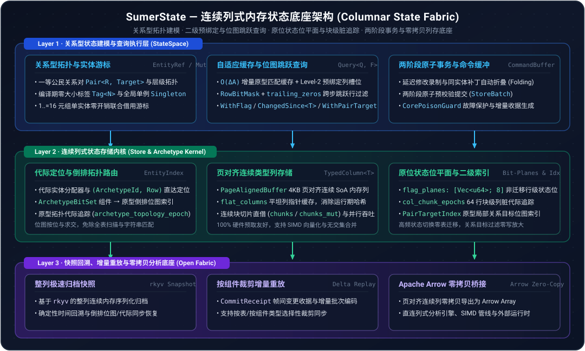

# SumerState

[](LICENSE)
[](Cargo.toml)
[](Cargo.toml)

[English](README.md) | 简体中文

**SumerState 是一个基于 Rust 构建的高性能连续列式内存状态引擎。** 它专为大规模仿真、数字孪生、实时游戏与数据密集型系统设计，将高表达力的关系型实体状态建模、确定性事务演进与零拷贝列式数据底座融为一体。

---

## 设计理念

传统的游戏框架（如 ECS）擅长极速的帧内遍历，但将世界状态局限于瞬态内存，缺乏严密的状态契约；而传统内存数据库具备严谨的事务与存储语义，却难以满足高频实时仿真的低延迟吞吐与细粒度演进需求。

SumerState 不局限于单一的 ECS 容器，而是将复杂的世界状态升格为一等公民的**列式状态底座（Columnar State Fabric）**——在兼具实体组件级缓存局部性与关系图谱表达力的同时，让每一次状态跃迁都具备事务级安全性、时间回溯确定性与开放的分析生态互操作性。

## 核心特性

- **纯连续列式存储**：密集、4KB 页对齐的连续列内存布局与平坦列指针缓存（`flat_columns`），兼顾 CPU 缓存线性扫描、SIMD 与多核并行吞吐。
- **关系型状态拓扑**：原生支持实体、强类型关系对（`Pair<R, Target>` + 原型内延迟位图二级索引）、层级结构、编译期零大小标签（`Tag<N>`）、非迁移行级状态位平面（`RowFlags`）与全局单例。
- **自适应预绑定与位图跳跃查询**：支持 `ArchetypeBitSet` 倒排索引、$O(\Delta A)$ 增量缓存刷新、Level-2 预绑定列槽位（`MatchedTableBinding`）、`RowBitMask` 硬件位跳跃过滤与 64 行块级增量脏追踪（`ChangedSince<T>`）。
- **两阶段事务演进**：支持延迟修改录制、同实体变更自动折叠与两阶段原子预校验提交，按需生成帧间增量收据。
- **零拷贝快照与开放底座**：原生集成 `rkyv` 整列极速归档、按组件裁剪的增量批次重放，以及 Apache Arrow 零拷贝内存桥接。
- **完备的验证套件**：内置 85 个状态与关系建模场景示例与测试，覆盖层级拓扑、模板继承、复杂查询、观察者与反射。

---

## 快速上手

```toml
[dependencies]
sumer_state = { git = "https://github.com/eventide-lab/SumerState" }
```

```rust
use serde::{Deserialize, Serialize};
use sumer_state::{Pair, QueryBuilder, Store};

#[derive(Debug, Clone, Copy, PartialEq, Serialize, Deserialize)]
struct Position { x: f32, y: f32 }

#[derive(Debug, Clone, Copy, PartialEq, Serialize, Deserialize)]
struct Velocity { x: f32, y: f32 }

#[derive(Debug, Clone, Copy, PartialEq, Eq, Hash, Serialize, Deserialize)]
struct Eats;

fn main() -> Result<(), Box<dyn std::error::Error>> {
    let mut store = Store::new();

    // 创建状态实体、挂载属性组件并建立关系拓扑 (Bob -> Eats -> Apples)
    let apples = store.spawn_auto()?;
    let bob = store.spawn_auto()?;
    store.set(bob, Position { x: 0.0, y: 0.0 })?;
    store.set(bob, Velocity { x: 1.0, y: 2.0 })?;
    store.set_pair(bob, Eats, apples)?;

    // 原位列式迭代更新
    for (_, (pos, vel)) in store.query_mut::<(&mut Position, &Velocity)>()?.iter() {
        pos.x += vel.x;
        pos.y += vel.y;
    }

    // 匹配包含 (Eats, apples) 关系对的实体状态（自动走原型内 PairTargetIndex 位图索引）
    let query = QueryBuilder::<&Position>::new().with_pair::<Eats>(apples).build(&store)?;
    query.for_each(&store, |pos| {
        println!("({}, {})", pos.x, pos.y);
    })?;

    Ok(())
}
```

### 运行场景示例

仓库在 [`examples/flecs`](examples/flecs) 下提供了 85 个完整的状态与关系建模示例：

```bash
cargo run --example flecs
cargo test --example flecs
```

---

## 架构概览

<p align="center">
  
</p>

---

## 路线图

- [x] 连续原型列式存储内核、代际实体分配器与 `ArchetypeBitSet` 倒排位图索引
- [x] 一等公民关系对（含 `PairTargetIndex` 二级索引）、零开销标签、非迁移行级状态位平面与全局单例
- [x] 流式查询、$O(\Delta A)$ 增量预绑定缓存查询、`RowBitMask` 位图跳跃过滤与 64 行块级增量脏追踪（`ChangedSince<T>`）
- [x] 两阶段原子命令缓冲、批量事务与增量收据
- [x] `rkyv` 整列快照、按组件裁剪增量重放与 Apache Arrow 零拷贝桥接
- [x] 85 个状态与关系建模场景验证套件
- [ ] 基于零拷贝 Arrow 列的 SQL / DataFusion 集成
- [ ] 面向跨语言仿真运行时的 C ABI / FFI 绑定

## 开源协议

基于 [MIT License](LICENSE) 开源。Copyright (c) 2026 Eventide.
